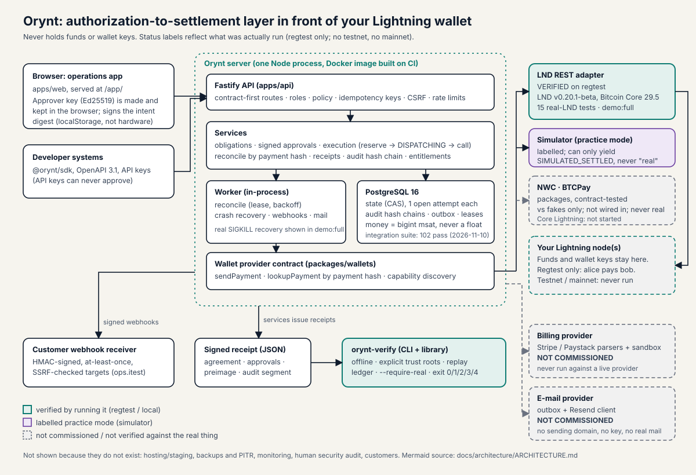

<p align="center"></p>

# Orynt: every payment, under control

**Payout-authorization software for organisations that pay people in bitcoin over Lightning.** Orynt sits between *"we decided to pay"* and the Lightning wallet you already run. It binds each payout to a signed approval of its exact terms, sends it **once**, treats a lost wallet response as **"checking", not "failed"**, settles only on cryptographic proof (the payment preimage), and issues a receipt that anyone can verify **offline without trusting Orynt**.

Orynt is **not a wallet**, never holds funds or wallet keys, and is **not a launched product**. "Orynt" is a working title with unresolved trademark risk ([`docs/brand/name-clearance.md`](docs/brand/name-clearance.md)). Built for the Dakar Bitcoin Hack 2026 (submission status: not submitted).

## Honest status (2026-11-11)

| Area | Status | Evidence |
|---|---|---|
| Control plane (state machine, signed approvals, single send, reconciler, receipts, audit chain) | **Verified** on real PostgreSQL: 102 integration tests, 51 unit tests (register run 2026-11-10) | [`docs/EXECUTION-REGISTER.md`](docs/EXECUTION-REGISTER.md) |
| **Real Lightning on regtest (LND)** | **Verified.** 15 real-LND tests pass; `pnpm demo:full` against Bitcoin Core 29.5 + two LND v0.20.1-beta nodes passes every assertion, including a real `SIGKILL` of the API after LND accepted a payment; real receipts verify with `--require-real` (re-run 2026-11-11) | [`docs/evidence/`](docs/evidence/README.md), [`docs/hackathon/demo-runbook.md`](docs/hackathon/demo-runbook.md) |
| Operations web app | 138 automated browser checks pass (practice wallet), axe serious/critical 0, no overflow at 375/768/1440 px. **No human usability or screen-reader testing** | [`docs/evidence/e2e-results.json`](docs/evidence/e2e-results.json) |
| Hosted CI | All 6 GitHub jobs green on the PR branch (verify, dependency audit, secret scan, real Lightning on regtest, browser E2E, container image builds and starts) | `gh run list` on PR #1 |
| Testnet / mainnet | **Never run.** Mainnet is disabled; only regtest is allowed by default | [`docs/product/wallet-capability-matrix.md`](docs/product/wallet-capability-matrix.md) |
| Wallets other than LND | **Not verified.** NWC and BTCPay adapters are implemented as packages and contract-tested against local fakes only; they are **not wired into the API** and were never run against a real wallet or server ([`docs/product/nwc-adapter.md`](docs/product/nwc-adapter.md), [`docs/product/btcpay-adapter.md`](docs/product/btcpay-adapter.md)). Core Lightning not started. No claim of support | same |
| Security review | Independent **AI** review with fixes and regression tests. **No human audit, no pen test** | [`docs/security/threat-model.md`](docs/security/threat-model.md) |
| Real e-mail, live billing | Implemented but **not commissioned**: mail goes to an outbox; billing parsers were never run against a live provider; no charge has ever been made | [`docs/OWNER-REPORT-R2.md`](docs/OWNER-REPORT-R2.md) |
| Hosting / staging / backups / monitoring | **Not deployed.** No public URL | [`docs/ops/production-readiness.md`](docs/ops/production-readiness.md) |
| Customers, users, revenue, partners | **None.** Market hypotheses are unvalidated | [`docs/business/README.md`](docs/business/README.md) |
| Legal review | **None.** Terms, privacy and prices are unreviewed drafts; plan prices are hypotheses | [`docs/business/legal-regulatory-register.md`](docs/business/legal-regulatory-register.md) |

## Quickstart A: see the real Lightning story (regtest, test coins)

Needs Linux x86_64, Node 22+, pnpm 10.28 (`corepack enable`), PostgreSQL 16 and internet access for the first download. No Docker.

```bash
pnpm install
pnpm db:start                    # local PostgreSQL via pg_ctlcluster (or set DATABASE_URL / TEST_ADMIN_DATABASE_URL)
bash infra/regtest/fetch.sh      # bitcoind 29.5 + lnd v0.20.1-beta; refuses on a SHA-256 mismatch
node infra/regtest/up.mjs        # 2 LND nodes, funded channel -> .regtest/env.json
pnpm test:real-lightning         # 15 real-LND tests
pnpm demo:full                   # A normal payout, B lost response, C SIGKILL recovery, D receipts + verifier + tamper
node infra/regtest/down.mjs
```

`demo:full` prints one line per assertion and ends with `ALL ASSERTIONS PASSED (real-regtest)`; evidence is written to `docs/evidence/`. In stage B the lost response is an **injected fault** (the payment itself is real regtest); stage C kills the process for real. Details and what each command prints: [`docs/hackathon/demo-runbook.md`](docs/hackathon/demo-runbook.md).

Check a real receipt offline (a committed sample from the 2026-11-11 run; the trust key here is read from inside the receipt, which only demonstrates the mechanics, a real verifier gets it out of band):

```bash
pnpm --filter @orynt/verifier build
R=docs/evidence/receipt-real-regtest-2026-11-11T10-26-29-483Z
K=$(node -e "console.log(JSON.parse(require('fs').readFileSync('$R-A.json','utf8')).issuer.public_key)")
node packages/verifier/dist/orynt-verify.mjs $R-A.json --trust-key $K --require-real --expect-network regtest; echo "exit=$?"   # VERDICT: VERIFIED, exit 0
node packages/verifier/dist/orynt-verify.mjs $R-A-TAMPERED.json --trust-key $K --require-real; echo "exit=$?"                  # one changed character: REJECTED, exit 1
```

## Quickstart B: practice mode in the browser (labelled simulator, no Bitcoin software)

```bash
pnpm install && pnpm db:start && pnpm build:all
ORYNT_ENV=development ORYNT_DEFAULT_PLAN=enterprise ORYNT_WEB_DIST=apps/web/dist ORYNT_SITE_DIST=apps/site/dist \
ORYNT_SEED_DEMO=1 ORYNT_FAILPOINTS=1 pnpm start
# site http://127.0.0.1:8787/   app http://127.0.0.1:8787/app/   (demo-owner@orynt.local / demo-password-123, public seed password: local use only)
```

Tested 2026-11-11 on a fresh database. The three extra variables are needed today: without `ORYNT_DEFAULT_PLAN=enterprise` the demo seed stops with `entitlement_exceeded` (the free plan allows 3 members and the seed adds 5), and without `ORYNT_WEB_DIST` / `ORYNT_SITE_DIST` the bundled server serves 404 for `/` and `/app/` (the Dockerfile sets them). Everything in the seeded workspace is labelled "SEED DATA / Practice wallet, no real value". `ORYNT_ENV` is mandatory; `production` refuses the simulator, failpoints and the seed.

## Architecture



Mermaid source, invariants and the execution protocol: [`docs/architecture/ARCHITECTURE.md`](docs/architecture/ARCHITECTURE.md). In short: browser/SDK -> Fastify API -> services + worker -> PostgreSQL; services call a wallet provider contract (LND REST verified on regtest; labelled simulator); receipts are verified offline by `orynt-verify`; billing and e-mail providers are drawn dashed because they are not commissioned.

| Path | What |
|---|---|
| `packages/core` | amounts (bigint msat), canonical JSON, BOLT11, state machine, policy, intent digest, audit chain, receipt schema |
| `packages/wallets` | wallet provider contract, LND REST adapter, labelled simulator |
| `packages/verifier` | `orynt-verify` CLI + library (offline receipt verification) |
| `packages/contract`, `packages/sdk` | single-source API contract -> OpenAPI 3.1 + typed client |
| `apps/api` | Fastify + PostgreSQL control plane, worker, migrations |
| `apps/web`, `apps/site` | operations app (React) and an 18-page product site |
| `infra/` | regtest scripts, PostgreSQL ops, Docker/deploy templates (unverified except the image build on CI) |
| `docs/` | architecture, security, ops, API, brand, business, research, hackathon, evidence |

## Verify the claims yourself

```bash
pnpm lint && pnpm typecheck && pnpm test         # unit: core 24, verifier 26, contract 1
pnpm test:integration                            # real PostgreSQL; with ORYNT_REGTEST_ENV set the 15 real-LND tests run too
node apps/web/e2e/run.cjs                        # browser E2E at 375/768/1440 + axe (needs Chromium; run pnpm build:all first)
pnpm restore:rehearsal                           # backup -> restore -> audit-chain re-verification
```

Claim-to-evidence map for every public statement: [`docs/hackathon/evidence-index.md`](docs/hackathon/evidence-index.md).

## Constraints and limits you should know about

- Not a custodian, exchange, escrow or trading tool. Approval and limit enforcement is **application-level**: anyone holding the wallet credential can bypass Orynt.
- The audit log is tamper-**evident**, not immutable. Approval keys live in browser storage (no hardware/passkey backing). MFA (TOTP) is opt-in per user; no SSO, no WebAuthn.
- A receipt proves a payment with a given hash settled with a given preimage; not delivery of work, payee identity or legal enforceability. A fake LND endpoint with a self-held preimage can still yield a "REAL" receipt (each receipt says so).
- Regtest only; no testnet or mainnet run; LND only; LND v0.20.1-beta with Bitcoin Core 29.5 (Core 32.1 was rejected by that LND).
- Nothing here is legal, tax or compliance advice. Commercial viability is an **unvalidated hypothesis**.

## Metrics to track (not yet measured; no users exist)

Onboarding completion, time to first authorised payout, exception time-to-resolution, duplicates blocked per 100 payouts (with sample size), regtest/practice usage reported separately from real-funds usage ([`docs/business/metrics-and-privacy.md`](docs/business/metrics-and-privacy.md)).

## What comes next (plans, not features)

Interviews with Bitcoin-native organisations (at least four in Africa) before building more; verified NWC and BTCPay adapters; hardware/passkey approval keys; mobile-first approval screens; a human security review and counsel review before any real-funds pilot; staging deployment, real e-mail and billing only with the owner's approval. See [`docs/R3-CLOSURE-REGISTER.md`](docs/R3-CLOSURE-REGISTER.md) and [`docs/OWNER-REPORT-R2.md`](docs/OWNER-REPORT-R2.md).

## AI-assistance disclosure

Built by one person with extensive assistance from an AI coding assistant (Claude Code); commits carry a `Co-Authored-By` trailer. The independent security review was also AI-performed. The code has not been reviewed line by line by a human.

License: Apache-2.0 (owner to confirm). Security: [`SECURITY.md`](SECURITY.md). Contributing: [`CONTRIBUTING.md`](CONTRIBUTING.md).
